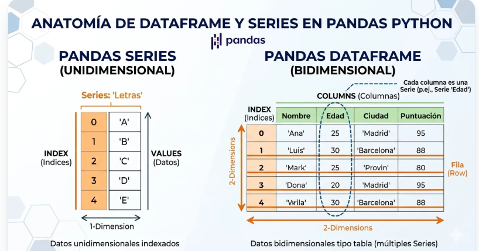
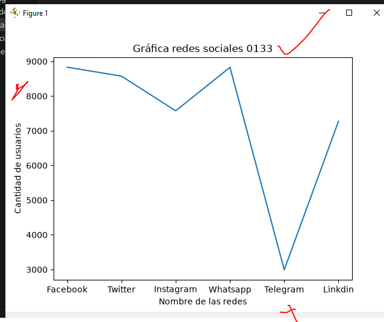
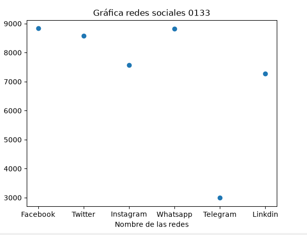
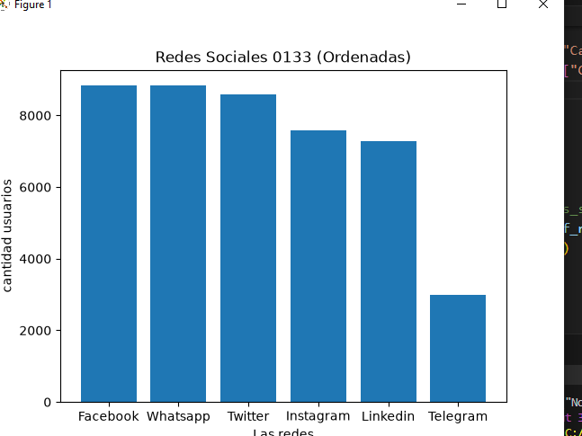
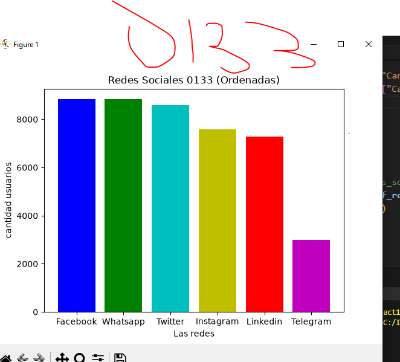
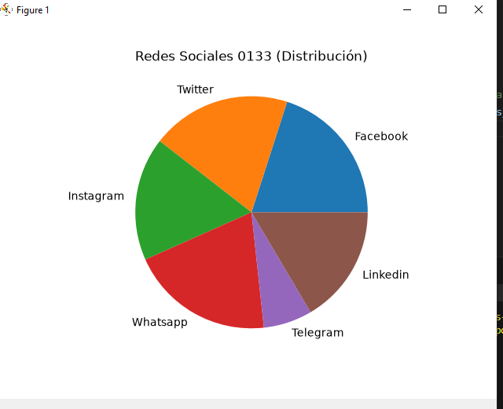

## dataframe  en marco de datos python

## redes sociales a nivel mundial

## GRafica de redes sociales

## Grafica de Puntos

## Grafica de barras 

## Grafica de barras de colores

## Grafica de pastel o pie

